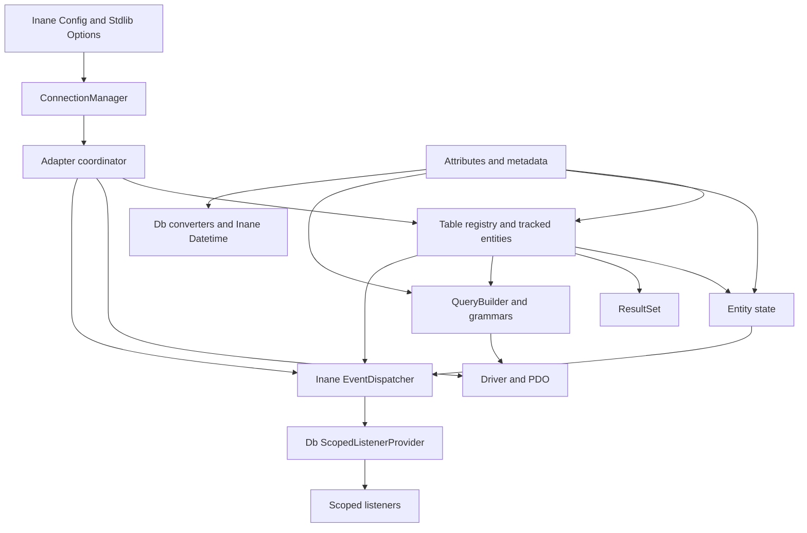

# Requirements

### Goal and agreed direction
Evolve the library in deliverable stages toward a managed, attribute-configured data layer—not a wholesale rewrite in one step.

Confirmed choices:
- An **in-place breaking major release**, with migration documentation rather than compatibility wrappers.
- **Tables own entity tracking and batching**; connections coordinate tables and transactions.
- **One scoped event dispatcher per connection**, supporting broad and narrow subscriptions.

Keep the existing PHP `>=8.5` baseline and standalone query-builder usage where practical. Reuse the sibling Inane libraries in `../` wherever their existing contracts fit, rather than duplicating infrastructure. Document required dependency changes and sibling-library impacts, including explicit no-change conclusions and deferred enhancements.

### First major-release scope
- Named PDO-backed connections, first registered connection as default, explicit default reassignment, lazy connection lifecycle, and connection-bound tables/entities.
- Table/column/foreign-key attributes and explicit database-to-PHP conversions, including datetime ↔ timestamp or formatted date string.
- Persisted snapshots, pending values, cancellable pre-change events, dirty inspection, selective discard/save, and explicit entity lifecycle states.
- Table-owned identity caches, single-record retrieval as `Entity|null`, and iterable multi-record result sets.
- Separate insert/update/delete persistence, transaction-safe state reconciliation, scoped connection/table/entity events, and bulk query planning.
- Save/discard scopes: connection → selected tables; table → tracked entities or selected entities/keys; entity → selected properties. Result sets expose dirty inspection of their members.

### Behavioral boundaries
- Changing an entity is **not** persistence. Rejected changes never alter its effective value; restoring a persisted value removes its pending change.
- Successful committed writes merge only persisted changes into the baseline and emit persistence events. Failed or rolled-back writes retain pending changes.
- Table-created entities are managed and new. Directly constructed entities are detached unless explicitly attached; save can resolve their table through a supplied manager and mapping.
- Each table always has an adapter reference, including an unconfigured adapter. Actual database operations on an unconfigured adapter fail clearly.
- Bulk operations minimize round trips where safe; a single SQL statement is an optimization, not a portability guarantee.

### Deferred
Foreign-key metadata is included now; relationship loading, cascading save/discard/delete, graph dirty traversal, dependency ordering, schema migrations, and distributed transactions are later work. Existing SQL joins remain available, without implying automatic entity-graph tracking. Adding a PostgreSQL connection driver is not required merely because PostgreSQL SQL generation already exists.

# Technical Design

### Existing foundation
- `src/Adapter/Adapter.php` eagerly chooses MySQL/SQLite drivers. `AdapterInterface` exposes only `getDriver()`; `src/Adapter/Driver/AbstractDriver.php` currently extends PDO.
- `src/Table/AbstractTable.php` uses static `$db`, combines query-builder calls with handwritten SQL, hydrates through `PDO::FETCH_CLASS`, and refetches after individual writes.
- `src/Entity/AbstractEntity.php` stores `$data`, uses PHP property hooks, and reflects `EntityBeforeSaveMethod` during save. It has no original/pending split.
- `src/Query/QueryBuilder.php` already delegates dialect behavior to grammars and supports single-row CRUD. Retain and extend this structure and its existing clause enums.

### Inane integration decisions
Use the existing `Inane\Event\EventDispatcher` with a Db-specific PSR-14 `ScopedListenerProvider`, as confirmed by the user; do not implement another dispatcher or add a facade. Use `Inane\Stdlib\Array\OptionsInterface` at configuration boundaries (also implemented by `Inane\Config\ConfigInterface`), then validate into immutable Db connection configuration. Preserve Stdlib export contracts and exception conventions. The **Inane Integration** tab owns the package dependency and sibling-change details.

### Connection ownership and identity
`Adapter` becomes the logical connection/coordinator; drivers own a nullable PDO instance rather than inheriting PDO. Driver contracts cover connect/disconnect, parameterized execution, transactions, and dialect capabilities. Connect lazily and reject disconnect during an active transaction; reconnect invalidates prepared-statement caches.

An explicitly supplied `ConnectionManager` creates/registers adapters, retrieves names, rejects duplicate names, and changes the default. Its first registered adapter becomes default unless explicitly overridden; defaults are manager-local, never process-global. Existing table bindings do not change when the default changes. Explicit registration keeps directly constructed adapters usable without hidden global state.

Distinguish **physical table identity** (driver/server endpoint/catalog/schema/table; SQLite file or connection-local memory identity) from **runtime ownership**. A table registry on each adapter returns the canonical table instance for that connection and mapping; duplicate conflicting registration fails. Separate connections to the same physical table never share mutable entities or transactions. A direct table constructor without an adapter receives an unconfigured adapter; canonical managed access goes through the registry.

### Mapping and conversion
Introduce immutable, cached metadata built from reflection, extending the existing attribute precedent:
```php
#[Table(name: 'orders', entity: Order::class, schema: 'sales')]
class Orders extends AbstractTable {}

#[Column(name: 'created_at', dbType: 'datetime', converter: UnixTimestampConverter::class)]
// Hooked entity property delegates access to the entity state store.

#[ForeignKey(table: Customers::class, column: 'id')]
// Declares metadata only; no cascade or automatic loading yet.
```
`Column` metadata includes primary/generated flags, nullability, size/precision and optional defaults. PHP property declarations define entity types; converters handle explicit database representations, formats and time zones. Conflicting or unsafe mappings fail during metadata compilation. Omitted, database-default, null and unloaded values remain distinct.

Mapped writes must pass through the entity mutation gateway. Support virtual property hooks delegating to that gateway and explicit accessors; do not claim an attribute alone can intercept arbitrary public-property writes. Hydration uses a dedicated internal path, not `FETCH_CLASS` assignment, and never emits user-change events. Start with scalar/immutable stored values; the Inane `Timestamp` converter stores canonical seconds and returns fresh wrappers, never a shared mutable baseline. Persisted primary keys are immutable in this release.

### Entity state and dirty contract
Store a persisted baseline, loaded-field information and a pending-value overlay. Effective reads prefer pending values. Track attachment separately from lifecycle (`New`, `Clean`, `Dirty`, `PendingDelete`, `Deleted`); assigning a primary key to a detached object does not prove that its row exists. Attachment states explicitly whether data represents an existing baseline or a new row.

Proposed core contracts:
```php
interface DirtyAwareInterface {
    public function isDirty(bool $recursive = false): bool;
}

// AbstractEntity
public function changes(): ChangeSet;
public function discard(string|array|null $properties = null): void;
public function save(string|array|null $properties = null,
    ?ConnectionManager $connections = null): PersistenceResult;

// AbstractTable; primary-key arrays mean lists of scalar keys initially.
public function save(AbstractEntity|array|int|string|null $selection = null): PersistenceResult;
public function discard(AbstractEntity|array|int|string|null $selection = null): void;

// Adapter
public function save(string|array|null $tables = null): PersistenceResult;
public function discard(string|array|null $tables = null): void;
```
Array alternatives receive precise list PHPDoc/types. `ChangeSet` exposes original/current values; `PersistenceResult` reports logical inserts/updates/deletes and affected identities. Empty selections select nothing; `null` means all owned items. Unknown fields, table names or incompatible entities fail rather than widening a scope.

Entity local dirtiness includes new/pending-delete lifecycle work and pending values. Table/connection local dirtiness means directly queued work, not descendant property edits; result sets have no independent pending writes and are locally clean. Recursive checks include tracked descendants, without loading relationships. Save selection always examines the selected entities' lifecycle and changes, regardless of a container's non-recursive result.

Discard on an existing entity restores selected pending fields; full discard also cancels a pending deletion. Full discard of a new entity removes its queued insertion and detaches it. Selective save on an existing entity persists only selected changes; partial insertion/deletion is rejected because those are whole-row operations.

A detached entity resolves its mapped table through a supplied manager or explicit binding; missing/ambiguous mappings fail clearly. Never silently rebind an attached entity to a different connection.

### Scoped events
Each adapter owns one `Inane\Event\EventDispatcher`, constructed with the Db `ScopedListenerProvider` implementing `Psr\EventDispatcher\ListenerProviderInterface`. The provider owns registrations, specificity ordering and matching, not invocation. Do not substitute Inane's class-only or prioritised providers for database-aware matching, or aggregate them in a way that loses global scope order.

Use structured selectors, not dot-string parsing, for connection/table/action/entity/primary-key/field specificity. New entities are addressable by object identity before they have a database key. Dispatch one logical event to matching registrations, broad scopes before narrow scopes, with stable registration order within a scope.

Separate immutable event payloads from cancellable dispatch state. Db pre-event envelopes extend `Inane\Event\StoppableEvent`; `reject()` records the veto and calls `stopPropagation()`. Stopping notification alone is not a veto: only rejection prevents mutation/persistence. Post-event envelopes can extend `Inane\Event\Event`; immutable payloads remain composed readonly values, not readonly subclasses of the mutable Inane base. Include operation/correlation identity, source, old/proposed values where applicable, and optional caller-supplied actor/context; never expose credentials or indiscriminately log field values.

For mutation: normalize → emit cancellable `Changing` → stop on rejection → apply pending value → emit `Changed`. Reverting to the normalized baseline clears the pending entry. Prevent recursive writes to the same field during its pre-change dispatch. Entity/table/connection subscriptions observe the same event rather than manufacturing duplicate forwarded events.

Connect/disconnect, select/fetch, insert/update/delete and errors have distinct event types. A bulk operation has connection/table summaries and individual entity outcomes; statement-level telemetry is separate. Pre-save veto aborts the selected operation before SQL. Existing `EntityBeforeSaveMethod` remains a mapped local pre-save hook whose mutations use the same gateway. Post-persistence events run only after commit and state reconciliation; listener failures cannot retroactively roll back committed data and are reported separately from database failure.

### Queries, reads and persistence
Table-bound builders consume metadata for identifiers, columns, keys, conversions and foreign-key descriptions. Retain `table(string)` for standalone SQL generation and add a metadata-bound route for table operations. Compile SQL plus ordered bindings and binding types into an immutable execution specification; validate identifiers and bind every value. Cache statements by connection generation, SQL and binding shape—not method name.

`getByPrimaryKey()` and explicit `getSingleItem()` execute with single-record intent and a limit of one; table query execution with an effective limit of one also returns `Entity|null`. Other reads return `ResultSet<TEntity>` even when zero or one row happens to match. Result sets retain a query snapshot, table reference and buffered entity list; implement `Iterator`/`Countable` plus `start()`/`end()`, with count meaning loaded page size, not total database matches. Empty records are `[]`. Repeated fetches reuse managed entity identity without overwriting pending changes.

Save plans distinguish inserts, dirty-column updates and scheduled deletes; saving is not implicit upsert. Operations are atomic per selected connection scope, with transaction ownership/savepoints explicit. Defer state merging and persistence notifications until the owning transaction commits; outer rollback preserves pending work and restores provisional generated identities. No cross-connection atomicity is promised.

Batch compatible insert shapes, use dialect-appropriate keyed bulk updates and `IN` deletes/refreshes, and chunk by parameter/statement limits. Do not overwrite unchanged columns. Retrieve generated keys using supported returning facilities; never infer all inserted keys from one `lastInsertId()`. Fall back to transactional prepared per-row execution where identity correlation or dialect support is insufficient. Refresh existing identities with chunked selects; reject refresh of dirty entities unless explicit discard is requested. Missing rows are reported, not converted silently into deletion success.

### Component flow


### File structure
Modify existing `src/Adapter/**`, `src/Entity/AbstractEntity.php`, `src/Entity/EntityBeforeSaveMethod.php`, `src/Table/AbstractTable.php`, `src/Query/QueryBuilderInterface.php`, `src/Query/QueryBuilder.php` and `src/Query/Grammar/**`.

Add focused classes under:
- `src/Adapter/`: `ConnectionManager`, validated connection configuration, Inane configuration factory and table-registry support.
- `src/Mapping/`: attributes, metadata factory/value objects and converter contracts/implementations.
- `src/Entity/`: lifecycle state and change-set support.
- `src/Event/`: event envelopes extending Inane events, immutable payloads, selectors and `ScopedListenerProvider`; no Db dispatcher implementation.
- `src/Persistence/`: dirty contract, table write plans and persistence results—not a separate unit of work.
- `src/Result/`: generic buffered result set.
- `src/Query/`: compiled execution specification.

Update `composer.json`/`composer.lock` for the dependencies described in **Inane Integration**. Extend `tests/Query/QueryBuilderTest.php`; add corresponding adapter/mapping/entity/event/table/result/persistence and Inane-integration suites. Document migration in `doc/readme/part/major-upgrade.adoc` and dependency contracts/sibling impacts in `doc/readme/part/inane-integration.adoc`, linked through `doc/readme/index.adoc`. Sibling source changes are not currently required; future changes must have their own package documentation, tests and release entry before Db relies on them.

# Inane Integration

### Reuse and dependency policy
Use Composer package dependencies, never relative source includes or a published dependency on the local `../` layout. Add direct requirements for `inanepain/event`, `inanepain/config`, `inanepain/datetime` and the PSR event contracts used by Db; retain `inanepain/stdlib`. Add `psr/log` for optional logger injection and suggest `inanepain/log` and `inanepain/servicemanager` as application integrations; include these optional implementations in development dependencies when exercising their integration examples. Choose minimum versions exposing the inspected APIs after checking available releases; record the actual constraints and lockfile resolution rather than inventing version numbers. Test against Composer-installed packages as well as the local sibling checkout when available.

| Library and inspected implementation | Planned Db reuse | Required sibling changes |
| --- | --- | --- |
| `../event/src/EventDispatcher.php`, `Event.php`, `StoppableEvent.php`, `Provider/ListenerProvider.php` | Existing dispatcher invokes listeners; Db supplies scope-aware provider and event envelopes. The existing general-purpose providers remain unchanged. | None: constructor injection of `ListenerProviderInterface` and stoppable events already supply the extension points. |
| `../stdlib/src/Array/OptionsInterface.php`, `Converters/Arrayable.php`, `Converters/JSONable.php` | Reuse options input, effective-value array/JSON export contracts already used by `AbstractEntity`, and existing Db-to-Stdlib exception inheritance. Db-specific state/SQL conversion remains in Db. | None: do not broaden generic options/export contracts with persistence concerns. |
| `../config/src/ConfigInterface.php`, `Config.php` | A Db factory accepts application configuration, obtains the `ConnectionManager` component via `getConfig(ConnectionManager::class)`, validates named connections/default and snapshots configuration. Arrays and existing `OptionsInterface` inputs remain usable without loading files. | None: file loading/merging stays with `Config::fromConfigFile()` in application bootstrap, not Db. |
| `../datetime/src/Timestamp.php` | Reuse `Timestamp` for Unix-second representations and an explicit optional entity wrapper conversion. Use `getDateTime(immutable: true)` and `DateTimeImmutable` for timezone-aware output. | None for this release: Db's strict converter bridges the parsing and mutability limitations below. |
| `../log/src/Logger.php` | Accept an optional constructor-injected `Psr\Log\LoggerInterface`; `Inane\Log\Logger` works unchanged. Emit safe operation/error metadata, not credentials or SQL binding values by default. | None: existing PSR-3 contract suffices; no mandatory writer or logging backend. |
| `../servicemanager/src/ServiceManager.php` | Document application factories registered with `register()` for the configured `ConnectionManager` and optional collaborators; use `createServiceManager()` for initialized services. Inject resolved dependencies into Db. | None: never make `ConnectionManager` inherit the service manager, use a global locator, or pass a container into entities. |
| `../cache/src/FilePool.php` | Do not use for entity identity or metadata caching in this release; retain adapter-local identity maps and in-memory metadata caching. | None required by Db. Its inspected PSR-6 methods have empty bodies; completing and testing them is a prerequisite only for a later persistent-cache feature. |

Other siblings are not automatic dependencies: authentication/actor resolution belongs to the caller, and this overhaul does not require routing, HTTP, session, Redis, encryption, or a new identifier generator. Keep operation correlation IDs injectable/local rather than adding a package solely for them.

### Configuration and value boundaries
- The configuration factory reads a component containing `connections` keyed by name and optional `default`; retain insertion order for the first-registered default. Validate options and reject conflicting names/defaults before any PDO connection is opened. Snapshot inputs so later mutation of an Inane options object cannot silently reconfigure an attached table.
- Preserve `Arrayable::toArray()` and `JSONable::toJSON()`/`jsonSerialize()` for entities as effective mapped values only. Keep `ChangeSet` explicit; never leak connection objects, event listeners or pending-state internals into serialization. Do not force result sets to inherit `Options`, whose arbitrary mutation API would undermine managed-record ownership.
- `Timestamp::createFromFormat()` currently uses PHP's default timezone and accepts warning-normalized dates; `format()` formats its epoch as UTC. Db conversion must parse with `DateTimeImmutable::createFromFormat()` using an explicit timezone, reset omitted components, inspect errors/warnings, reject invalid input and apply the configured output timezone. It must not change the process timezone or use fuzzy parsing for persisted values.
- `Timestamp::adjust()`/`modify()` mutate the wrapper. Normalize assignments to scalar seconds and return a fresh wrapper on each effective read; callers reassign modified wrappers through the mutation gateway to mark changes. Use seconds only for this representation; reject non-zero fractional seconds rather than silently losing precision. Use an immutable date representation where precision must be retained.

### Sibling change register and documentation
No mandatory sibling source/API changes were found for the chosen first-release integration. The required changes are Db dependencies, adapters, integration tests and documentation—not edits to unrelated libraries.

Record this matrix, actual minimum versions, configuration/factory examples, event rejection semantics and datetime limitations in `doc/readme/part/inane-integration.adoc`. Keep the matrix current throughout delivery. Any subsequently discovered sibling blocker must be documented there with its package/file, current limitation, proposed signature, compatibility impact, owning delivery stage, tests and minimum release; implement/release the generic change in its owning package before raising Db's dependency floor. Never hide a sibling patch inside a Db workaround or vendor edit.

Deferred, non-blocking enhancement candidates must be labelled separately from required work:
- `inanepain/datetime`: an additive timezone-aware strict parsing API could replace the Db parsing bridge later; preserve existing permissive methods and document/test invalid dates, timezone handling and epoch zero in that package if introduced.
- `inanepain/cache`: completing `FilePool` needs PSR-6 behavior tests and package documentation before optional persistent metadata caching is considered. It must never hold live PDO handles or managed entity identity maps.

# Testing

### Approach
Retain the SQL/grammar assertions and data-provider pattern in `tests/Query/QueryBuilderTest.php`. Add isolated unit tests and in-memory SQLite integration tests, plus MySQL execution tests when a test database is available. PostgreSQL remains SQL-generation coverage unless a driver is added separately.

### Main checks
- Exercise real `Inane\Event\EventDispatcher` with the Db provider: scope order, one delivery per matching registration, `reject()` versus propagation-only stop, exceptions and per-connection isolation.
- Verify array/Stdlib Options/Inane Config input parity, class-keyed component lookup, explicit defaults and configuration snapshot isolation; smoke-test documented service-manager factories and an injected `Inane\Log\Logger` with a capturing writer, checking redaction.
- Verify existing entity array/JSON contracts expose effective values only; check Inane Timestamp epoch zero/negative values, invalid dates, explicit timezone behavior, mutable-wrapper reassignment and fractional-second rejection.
- Resolve declared package constraints using Composer-installed dependencies; keep optional logging/service-manager examples testable without turning them into runtime requirements.
- Named/default connections, duplicate registration, lazy lifecycle, unconfigured errors, connection isolation and canonical table identity.
- Metadata validation, hooked-property enforcement, database/PHP conversion round trips, null/default/unloaded distinctions, datetime formatting/time zones.
- Veto before mutation, change-and-revert, selective discard, detached attachment, new/delete lifecycle and all levels of recursive/non-recursive dirtiness.
- Broad-to-narrow event ordering, single-delivery semantics, actor/context, generated-key selectors, reentrancy protection and post-commit listener failure behavior.
- Primary-key/limit-one nullability, empty and populated result sets, iteration boundaries, identity reuse and protection of pending values during reads/refreshes.
- Single and selected-field persistence, scoped table/key filters, empty scopes, no-op saves, partial insert/delete rejection and absence of accidental upserts.
- Bulk mixed operations, differing column shapes, chunk boundaries, safe generated-key correlation, failed chunks, outer rollback and no premature state merge/events.
- Instrument executed statements to prove eligible bulk operations reduce round trips; test and document safe fallbacks rather than imposing unrealistic one-query expectations.

### Tooling and status
Use strict types and precise generic/list annotations throughout. Retain the existing Psalm configuration, but establish a reproducible compatible Psalm development dependency before relying on it; do not suppress new findings to obtain a pass. Adjust `phpunit.xml`'s current parent-relative bootstrap if needed for package-local execution. Tests and static analysis are validation within each delivery phase, not a separate final phase. Only this plan has been updated; no source files have been changed and no test run is claimed.

# Delivery Steps

###   Step 1: Introduce named, connection-bound adapters and table ownership
Adapters support managed names, lazy PDO lifecycle and isolated table ownership without static table connections.
- Evolve `AdapterInterface`, `Adapter`, `DriverInterface` and existing drivers to PDO composition with explicit execution/transaction contracts.
- Add `ConnectionManager` with manager-local first-registered default, lookup and reassignment.
- Add a configuration factory using Stdlib `OptionsInterface`/Inane `ConfigInterface`, snapshot and validate named configuration, and document application-owned Inane service-manager factories.
- Add the planned Composer dependencies and optional PSR-3 logger injection; test configuration parity, factory wiring and safe logging.
- Replace `AbstractTable::$db` with instance ownership and add canonical table registration plus unconfigured-adapter behavior.
- Test defaults, connection isolation, duplicate names/tables, lazy connection and disconnect safeguards.
- Begin the major-upgrade documentation with constructor and connection migration examples; add `doc/readme/part/inane-integration.adoc` with the dependency/sibling-change register and link it from `doc/readme/index.adoc`.

###   Step 2: Add attribute metadata and database-to-entity conversions
Tables and entities have validated, cached mapping metadata used by table-bound queries and hydration.
- Add table, column and foreign-key attributes under `src/Mapping/`, following `EntityBeforeSaveMethod`'s existing attribute precedent.
- Add immutable metadata and converter contracts covering keys, defaults, nullability, dimensions and explicit datetime representations.
- Reuse Inane `Timestamp` through a strict timezone-aware Db converter bridge; store canonical seconds, isolate mutable wrappers, and reject precision loss. Document why no datetime sibling change is required.
- Add the metadata-bound query route while retaining standalone string-table builders.
- Define the hooked-property mutation gateway and reject mappings whose writes cannot be tracked safely.
- Test mapping conflicts, type conversions, timestamp/date-string round trips and missing/null/default distinctions.

###   Step 3: Implement tracked entity changes and scoped events
Entities expose pending changes and cancellable mutation, with connection-scoped event subscriptions.
- Rework `AbstractEntity` around baseline/loaded/pending state and explicit attachment/lifecycle states.
- Add change inspection, selective/full discard and the dirty contract, including local versus recursive semantics.
- Implement `ScopedListenerProvider`, selectors, readonly payloads and event envelopes under `src/Event/`; instantiate one existing `Inane\Event\EventDispatcher` per connection rather than writing another dispatcher.
- Add Db subclasses of Inane stoppable events with explicit rejection state; leave the event library unchanged and test rejection versus propagation-only stopping and broad-to-narrow delivery with the real dispatcher.
- Preserve Stdlib entity array/JSON export interfaces and test effective-value serialization without leaking tracking infrastructure.
- Route property hooks and explicit setters through normalization, veto and apply; separate hydration from user mutation.
- Test rejected changes, reversion, nulls, detached/new entities, event ordering, duplicate-delivery prevention and same-field reentrancy.

###   Step 4: Deliver managed reads and iterable result sets
Table reads return canonical managed entities or buffered result sets according to explicit query cardinality.
- Replace `FETCH_CLASS` hydration and handwritten read SQL in `AbstractTable` with metadata-aware execution.
- Implement table-owned entity identity caches and creation of managed new entities.
- Add `ResultSet<TEntity>` with query snapshot, table reference, records, iterator/count and boundary navigation.
- Enforce `Entity|null` for primary-key/single/limit-one reads and result sets for other reads.
- Test empty reads, repeated-key identity, connection isolation, cardinality and protection of unsaved values during hydration.

###   Step 5: Implement transaction-safe entity and table persistence
Single-record and filtered table saves persist explicit lifecycle operations and reconcile state only on commit.
- Replace implicit `insertUpdate` saving and method-keyed statement caches with insert/update/delete plans and compiled parameterized execution specifications.
- Implement entity/table selection, selective column saves, detached resolution and scheduled deletion; integrate existing before-save attributes.
- Add persistence results, pre-save cancellation, transaction/savepoint ownership and deferred state/event reconciliation.
- Preserve pending work and provisional identity correctness on failure or outer rollback; report post-commit listener failures distinctly.
- Test dirty-column SQL, filtered/no-op saves, partial-operation rejection, generated keys, commit events and rollback behavior; document API migration.

###   Step 6: Add bulk planning and connection-wide save/discard scopes
Connection, table and result-set dirty inspection integrates with scoped bulk persistence and refresh.
- Extend table write planning and dialect grammars for compatible multi-row inserts, keyed updates and bulk deletes, with parameter-aware chunking and safe fallbacks.
- Add chunked refresh reads and generated-key correlation without assuming contiguous IDs.
- Implement connection-selected-table save/discard, table entity/key scopes and recursive dirty aggregation over tracked ownership.
- Emit connection/table operation summaries and individual entity outcomes without conflating them with SQL statement telemetry.
- Verify statement counts, mixed batches, chunk failures, filtered discard, atomic connection saves and generated-key fallbacks using SQLite plus available MySQL integration coverage.
- Complete staged migration and Inane-integration documentation, including actual dependency floors and the final sibling-impact register; required sibling changes, if any arise, must identify their owning package, compatibility impact, tests and release prerequisite.
- Keep optional datetime/cache enhancements and relationship traversal/cascades explicitly deferred, not implicit functionality in this release.